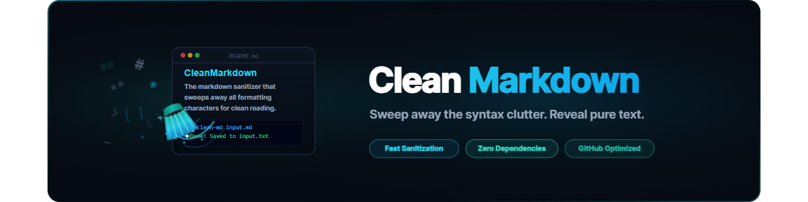
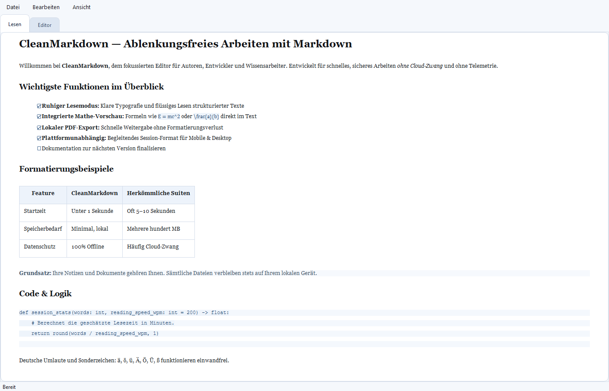
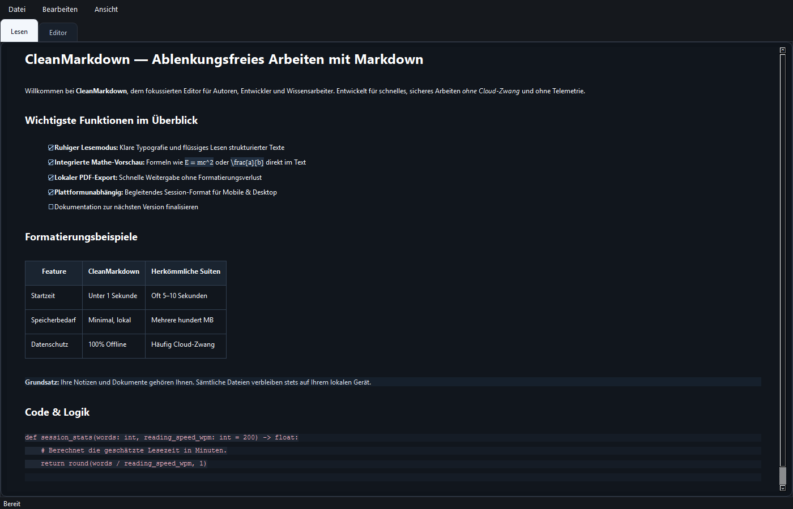
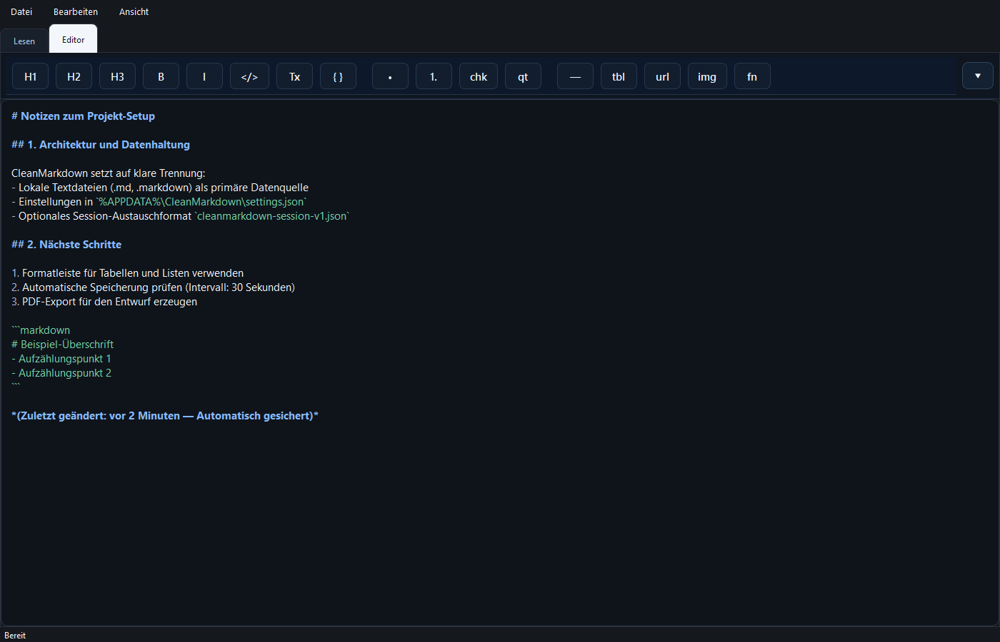
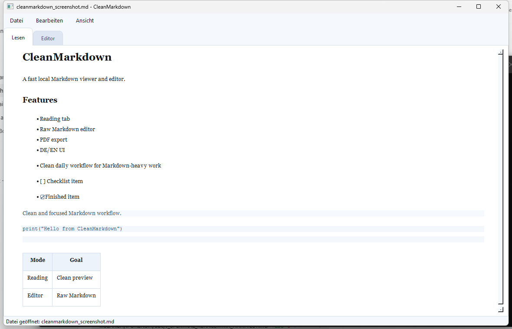
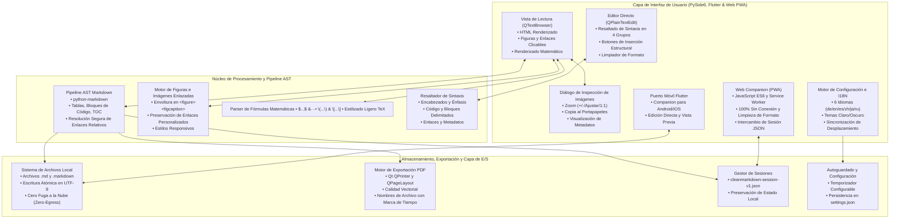
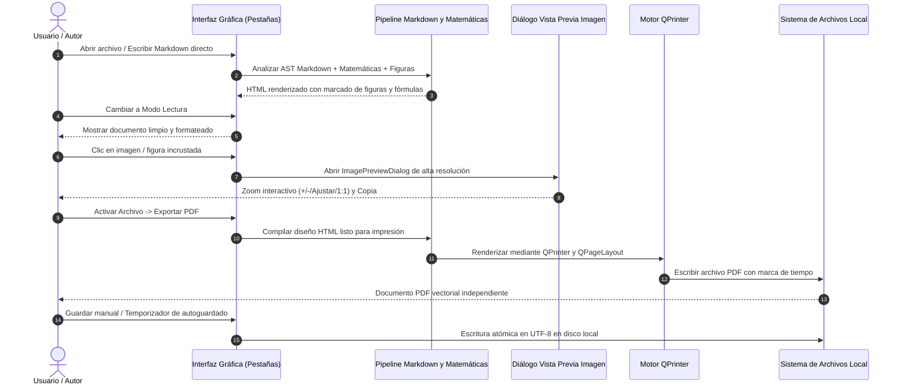

# CleanMarkdown

[English](README.md) · [Deutsch](README_DE.md) · **Español**

> **Visor y editor local de Markdown rápido y sin distracciones con modo de lectura en vivo, editor con resaltado de sintaxis, inspección de imágenes en alta resolución, vista previa matemática, exportación a PDF con marca de tiempo e interfaz en 6 idiomas (`de`, `en`, `es`, `zh`, `ja`, `ru`).**

[](https://github.com/doc-bricks)
[](https://github.com/open-bricks)
[](https://github.com/doc-bricks/CleanMarkdown/actions/workflows/tests.yml)
[](LICENSE)
[](https://python.org)
[](https://github.com/doc-bricks/CleanMarkdown)
[](SECURITY.md)
[](SECURITY.md)
[](tests)
[](CHANGELOG.md)
[](CHANGELOG.md)
[](llms.txt)

> [!NOTE]
> Resumen del proyecto legible por máquina y contexto para IA disponible en [`llms.txt`](llms.txt). La política de seguridad y las garantías de privacidad local están documentadas en [`SECURITY.md`](SECURITY.md).

---

## Quick Navigation / Navegación rápida

- [Características principales](#características-principales)
- [Galería visual y capturas de pantalla](#galería-visual-y-capturas-de-pantalla)
- [Arquitectura y flujo de trabajo](#arquitectura-y-flujo-de-trabajo)
- [Ciclo de vida del documento y exportación](#ciclo-de-vida-del-documento-y-exportación)
- [Familia de productos y matriz de compatibilidad](#familia-de-productos-y-matriz-de-compatibilidad)
- [Instalación y guía de inicio rápido](#instalación-y-guía-de-inicio-rápido)
- [Uso y atajos de teclado](#uso-y-atajos-de-teclado)
- [Resaltado de sintaxis en el editor](#resaltado-de-sintaxis-en-el-editor)
- [Privacidad local y seguridad (Local-First)](#privacidad-local-y-seguridad-local-first)
- [Herramientas hermanas y ecosistema documental](#herramientas-hermanas-y-ecosistema-documental)
- [Desarrollo y conjunto de pruebas](#desarrollo-y-conjunto-de-pruebas)
- [Licencia y soporte](#licencia-y-soporte)

---

## Características principales

- **Espacio de trabajo de doble pestaña**: Cambio instantáneo entre la vista renderizada de `Lectura` y el `Editor` directo con sincronización opcional de desplazamiento.
- **Apertura segura en UTF-8**: Los archivos con codificación UTF-8 no válida se rechazan antes de reemplazar el documento activo, preservando los cambios no guardados y los bytes originales.
- **Editor Markdown directo**: Edición directa de Markdown con convenientes botones de asistencia para encabezados, tablas, enlaces, imágenes y listas de tareas sin la complejidad de WYSIWYG.
- **Limpieza de formato**: Elimine la sintaxis de Markdown del texto seleccionado con un solo clic para comenzar con texto limpio.
- **Inspección interactiva de imágenes**: Cuadro de diálogo de alta resolución `ImagePreviewDialog` con zoom (+/- / Ajustar / 1:1), copia al portapapeles y metadatos de imagen.
- **Renderizado de figuras e imágenes enlazadas**: Envoltura automática de imágenes independientes en elementos `<figure>` y `<figcaption>` preservando totalmente los enlaces personalizados.
- **Vista previa matemática ligera**: Renderizado de fórmulas para `$...$`, `$$...$$`, `\(...\)` y `\[...\]` en modo de lectura y exportaciones a PDF sin dependencias externas de TeX.
- **Exportación vectorial a PDF**: Generación de documentos PDF limpios e imprimibles con nombres basados en marcas de tiempo.
- **Formato de sesión estandarizado**: Exportación e importación de `cleanmarkdown-session-v1.json` para una transferencia transparente entre dispositivos y la app complementaria.
- **Autoguardado y persistencia**: Intervalo de autoguardado configurable con escrituras atómicas en disco local y gestión segura de configuración.
- **Interfaz en 6 idiomas**: Localización completa en alemán (`de`), inglés (`en`), español (`es`), chino (`zh`), japonés (`ja`) y ruso (`ru`).
- **Temas claro y oscuro**: Paletas de colores calibradas con resaltado de sintaxis agradable para la vista.
- **Resolución relativa de recursos**: Los enlaces a imágenes y documentos locales se resuelven automáticamente de forma relativa a la carpeta del documento activo.
- **Línea móvil y multiplataforma**: Companion móvil en Flutter (`flutter_port/`) para Android e iOS con acceso nativo sin conexión a archivos.

---

## Galería visual y capturas de pantalla

CleanMarkdown presenta una interfaz libre de distracciones diseñada tanto para una lectura cómoda de textos extensos como para una edición precisa de Markdown en código fuente:

| Modo lectura (Tema claro) | Modo lectura (Tema oscuro) |
| :---: | :---: |
|  |  |
| *Vista de lectura renderizada con tipografía limpia, matemáticas y figuras* | *Modo oscuro agradable para la vista con contraste sutil* |

| Editor de código fuente Markdown | Vista general del espacio de trabajo |
| :---: | :---: |
|  |  |
| *Resaltado de sintaxis sobrio en 4 grupos y barra de herramientas* | *Diseño de ventana completa con barra de pestañas y estado* |

---

## Arquitectura y flujo de trabajo

CleanMarkdown mantiene una estricta separación entre la capa de interfaz de usuario, la transformación del AST de Markdown y los motores de almacenamiento/exportación local:



---

## Ciclo de vida del documento y exportación

El diagrama de secuencia describe el flujo de apertura, edición, inspección interactiva y exportación:



---

## Familia de productos y matriz de compatibilidad

CleanMarkdown ofrece diversas ediciones alineadas para soportar la lectura y escritura local en múltiples plataformas:

| Característica / Entorno | 💻 Aplicación de Escritorio (PySide6) | 📱 Puerto Móvil (Flutter) | 🌐 Web Companion (PWA) |
| :--- | :--- | :--- | :--- |
| **Plataforma principal** | Windows / Linux / macOS | Android / iOS | Navegadores modernos (PWA sin conexión) |
| **Listo sin conexión** | Sí (100% offline, zero-egress) | Sí (completamente offline) | Sí (100% offline, Service Worker) |
| **Acceso a archivos** | Sistema de archivos local directo | Almacenamiento local / Selector de docs | LocalStorage / File System Access API |
| **Opciones de exportación** | Exportar PDF, Markdown directo, Sesión JSON | Archivo Markdown local | Markdown limpio, Sesión JSON, Texto directo |
| **Autoguardado** | Intervalo de temporizador configurable | Flujo de guardado manual | Persistencia de estado en LocalStorage |
| **Vista previa matemática**| Sí (ligera en línea / en bloque) | Sí (renderizado en móvil) | Renderizado tipográfico ligero |
| **Inspección de imágenes** | Zoom interactivo y diálogo de metadatos | Zoom táctil móvil (pinch-to-zoom)| Vista previa adaptable en línea |
| **Transferencia de datos**| Exportar/Importar `cleanmarkdown-session-v1.json` | Transferencia de archivos | Soporte completo de `cleanmarkdown-session-v1.json` |

---

## Instalación y guía de inicio rápido

### Requisitos

- Python 3.10, 3.11, 3.12 o 3.13
- Dependencias indicadas en `requirements.txt` (`PySide6`, `markdown`)

### Pasos

```powershell
python -m pip install -r requirements.txt
python main.py
```

O iniciar directamente en Windows:

```bat
start.bat
```

El script de inicio para Windows ejecuta la copia actual del código fuente, utilizando `.venv` cuando existe y, en caso contrario, el ejecutable de Python disponible en `PATH`. Reenvía argumentos (por ejemplo, `start.bat --self-test`) sin llamar a ejecutables antiguos.

### Instalación local frente a Microsoft Store — no ejecutar ambas a la vez

`install_local.ps1` registra CleanMarkdown como gestor local de archivos `.md` (su propio ProgID `CleanMarkdown.mdfile`, `%LOCALAPPDATA%\Programs\CleanMarkdown`, acceso directo en el Menú Inicio). Instalar CleanMarkdown desde Microsoft Store además de eso **no reemplaza la asociación local de archivos**: prevalece el ProgID elegido actualmente en `UserChoice`. Mantener ambas versiones provoca que los archivos `.md` sigan mostrando el icono del ejecutable antiguo incluso tras actualizar el paquete de Store.

**Recomendación:** utilice solo un método de instalación al mismo tiempo:

1. Instale o actualice primero la versión de Microsoft Store.
2. Vista previa: `.\uninstall_local.ps1 -WhatIf` (sin cambios).
3. Desinstalación limpia: `.\uninstall_local.ps1` (solicita confirmación antes de modificar el registro y elimina únicamente lo creado por `install_local.ps1`).
4. Configuración de Windows → Aplicaciones → Aplicaciones predeterminadas → ".md" → seleccionar CleanMarkdown (Store) manualmente.
5. Verifique el resultado en el Explorador de Windows.

---

## Uso y atajos de teclado

1. **Abrir y Crear**: Abra archivos `.md`/`.markdown` existentes o sesiones `cleanmarkdown-session-v1.json` desde `Archivo -> Abrir...` (`Ctrl+O`), o comience a escribir en el editor.
2. **Cambio de pestañas**: Alterne entre las pestañas `Lectura` y `Editor` (`Ctrl+1` / `Ctrl+2` o barra de pestañas).
3. **Formateo e inserción**: Utilice la barra de herramientas del editor para insertar encabezados, listas, tablas, enlaces, bloques de código o eliminar el formato.
4. **Inspección de imágenes**: Haga clic en cualquier imagen renderizada en la vista de lectura para abrir el visor interactivo de alta resolución con Zoom y Copia al portapapeles.
5. **Exportación a PDF**: Exporte el documento actual mediante `Archivo -> Exportar PDF` (`Ctrl+Shift+P`) para generar un PDF vectorial.
6. **Transferencia de sesión**: Guarde el estado completo de su sesión mediante `Archivo -> Exportar sesión` para transferencias locales.
7. **Configuración**: Ajuste el idioma, tema, intervalo de autoguardado, visibilidad de la barra de herramientas y sincronización de desplazamiento en `Ver -> Configuración`.

Los enlaces relativos a imágenes como `` se resuelven contra el directorio del documento activo. Al guardar con un nombre nuevo, las rutas se actualizan automáticamente.

---

## Resaltado de sintaxis en el editor

El editor de código fuente Markdown emplea un esquema sobrio y agradable en 4 grupos cromáticos:

- **Encabezados y Énfasis** (Azul): Marcadores estructurales (`#`, `##`) y texto en negrita/cursiva.
- **Código y Bloques delimitados** (Verde): Comillas simples invertidas y bloques de código multilinea.
- **Enlaces y Metadatos** (Rosa/Magenta): URLs, rutas relativas, destinos de imágenes y notas al pie.
- **Estructura y Marcado** (Gris-Violeta suave): Listas, citas en bloque, reglas horizontales y delimitadores de tabla.

---

## Privacidad local y seguridad (Local-First)

CleanMarkdown está construido desde sus cimientos bajo estrictos principios de soberanía de datos y cero nube:

- **100% Fuera de línea (Zero-Egress)**: Sin dependencias en la nube, sin llamadas a APIs remotas, sin analítica y sin rastreo.
- **Límites locales de archivo**: Las operaciones sobre archivos se limitan estrictamente a las rutas elegidas por el usuario con protección contra escapes de directorio.
- **Sin privilegios elevados (Non-Elevation)**: Se ejecuta completamente en modo usuario estándar sin requerir derechos de administrador.
- **Política de seguridad y SLA**: Las pautas de notificación y compromisos de atención (SLA de respuesta de 48 horas para avisos de seguridad) están documentados en [`SECURITY.md`](SECURITY.md).

---

## Herramientas hermanas y ecosistema documental

CleanMarkdown forma parte de la suite documental [`doc-bricks`](https://github.com/doc-bricks) y del ecosistema abierto local-first [`open-bricks`](https://github.com/open-bricks):

| Repositorio | Enfoque y Dominio | Aspectos destacados |
| :--- | :--- | :--- |
| **[doc-bricks/CleanMarkdown](https://github.com/doc-bricks/CleanMarkdown)** | Lector y editor local rápido de Markdown | Interfaz en 6 idiomas, exportación PDF, fórmulas matemáticas, zero-egress |
| **[doc-bricks/FormularErstellen](https://github.com/doc-bricks/FormularErstellen)** | Creador interactivo de formularios AcroForm y PDF rellenables | Diseñador visual, validación de esquemas, cero nube |
| **[doc-bricks/DokuZen](https://github.com/doc-bricks/DokuZen)** | Visor minimalista de documentación técnica | Navegador de documentación offline con búsqueda instantánea |
| **[doc-bricks/UniversalDocsGrabber](https://github.com/doc-bricks/UniversalDocsGrabber)** | Agregador de documentos y archivos adjuntos | Ingestión IMAP, deduplicación SHA-256, exportación OCR |
| **[doc-bricks/PDFtoPDFocr](https://github.com/doc-bricks/PDFtoPDFocr)** | OCR local para PDF y capa de texto indexable | Pipeline Tesseract OCR 100% offline |
| **[file-bricks/WinStorePackager](https://github.com/file-bricks/WinStorePackager)** | Empaquetado MSIX y preparación para Microsoft Store | Validación WACK, generador de manifiestos, almacenamiento seguro |
| **[file-bricks/ExplorerPro](https://github.com/file-bricks/ExplorerPro)** | Administrador de archivos local con pestañas | Búsqueda FTS5 de alto rendimiento, operaciones por lotes |
| **[file-bricks/ProSync](https://github.com/file-bricks/ProSync)** | Motor de sincronización bidireccional y respaldo SQLite WAL | Puntos de control seguros, zero-egress, registros de auditoría |
| **[dev-bricks/CodeBox](https://github.com/dev-bricks/CodeBox)** | Cuaderno de notas y fragmentos de código offline | Resaltado de sintaxis, búsqueda instantánea, almacenamiento local |
| **[ellmos-ai/ellmos-filecommander-mcp](https://github.com/ellmos-ai/ellmos-filecommander-mcp)** | Operaciones de archivos bajo el protocolo MCP | Herramientas seguras para agentes con protección dry-run |
| **[open-bricks/open-bricks](https://github.com/open-bricks)** | Fundación umbrella para aplicaciones de escritorio local-first | Directrices estandarizadas de calidad, empaquetado y privacidad |

---

## Desarrollo y conjunto de pruebas

El [contrato de CI](docs/CI-CONTRACT.md) enumera las verificaciones de escritorio, contratos web, Flutter y pruebas de humo, junto con sus límites de aceptación.

```powershell
python -m pip install -r requirements.txt pytest ruff
python -m py_compile main.py translator.py
ruff check .
python -m pytest -q
python main.py --self-test
```

El conjunto de pruebas valida la precisión del renderizado, la preservación de hipervínculos en figuras, el procesamiento matemático, la serialización de sesiones, la persistencia de configuración, el guardado atómico de documentos, la impresión sin entorno gráfico, la paridad de recursos y la sincronización automatizada de contratos de metadatos (285 pruebas superadas).

---

## Licencia y soporte

Este proyecto está bajo la [Licencia MIT](LICENSE).

Para soporte, solicitudes de nuevas funciones o preguntas, visite nuestro [Rastreador de Problemas (Issue Tracker)](https://github.com/doc-bricks/CleanMarkdown/issues) o consulte [`SUPPORT.md`](SUPPORT.md).
